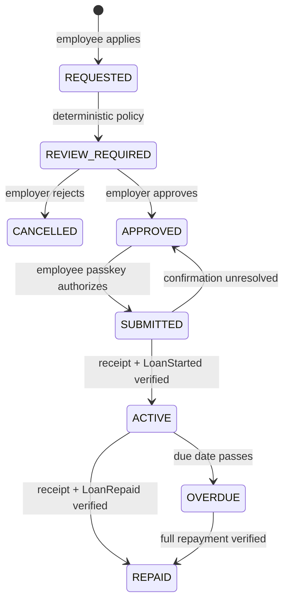

# QastFund technical architecture

Status: implemented architecture reviewed for the controlled Arc Testnet pilot.

This document describes the repository as it exists for the accepted two-user,
test-fund-only validation scope. It does not represent production security or
regulatory certification.

## System context

```text
Public browser ── HTTPS ──> Caddy edge
                              │
                              │ private `web` network
                              ▼
Employee portal ───────┐   Next.js application
Employer portal ───────┼──> routes + application services
Public pages ──────────┘            │
                                    ├── PostgreSQL (`internal` network)
                                    ├── ERPNext HTTPS API (read-only employee data)
                                    ├── Circle Modular Wallet service
                                    └── Arc Testnet RPC / escrow contract

Internal scheduler ── bearer-authenticated calls ──> Next.js internal routes
                                    │
                                    └── reconciliation and ERPNext job state
```

The production Compose file publishes only Caddy ports 80/443. PostgreSQL and
the scheduler attach only to the internal Docker network; the application joins
the internal and web networks; Caddy joins the web network. The target host's
firewall and container bindings require separate operator evidence, as recorded
in `CONTROLLED_PILOT_READINESS.md`.

## Application shape

QastFund is a Next.js modular monolith backed by one PostgreSQL database. It
serves:

- a public product and authentication experience;
- an employee portal under `/app`;
- an employer-administrator portal under `/employer`;
- Route Handlers under `/api` for authenticated commands and queries;
- bearer-authenticated internal scheduler routes for ERPNext synchronization
  and Arc reconciliation.

The dependency direction is:

```text
UI / Route Handler
        ↓
Application use case
        ↓
Domain rules + repository/integration ports
        ↓
Infrastructure adapters
        ↓
PostgreSQL / ERPNext / Circle / Arc
```

Route handlers translate HTTP input and output. Application services coordinate
workflows. Domain modules hold rules and state transitions. Infrastructure
adapters implement persistence and provider access. UI code does not directly
query Prisma or decide authorization.

## Frontend and API

Next.js App Router route groups separate the public, employee, employer, and
shared authenticated experiences. Server Components load authorized view
models; Client Components are limited to browser interaction such as Circle
wallet operations and form submission.

External input is validated with Zod. APIs return a shared error envelope and
do not expose stack traces, raw provider responses, or configuration secrets.
Financially meaningful commands use request identifiers, persisted intents,
transaction-hash binding, and database constraints so retries do not create a
second operation.

## Authentication, tenancy, and authorization

Local email/password authentication is behind the auth module. Passwords use
scrypt hashes. Sessions use random bearer tokens; only a SHA-256 token hash is
stored in PostgreSQL. The session cookie is `HttpOnly`, `SameSite=Lax`, and
`Secure` when `NODE_ENV=production`.

Every protected request resolves the session, active organization membership,
and role from the database. The browser cannot supply a trusted organization or
role. Tenant-owned repository operations require `organizationId`; resource
ownership and lifecycle status are checked in addition to role. Employer loan
review requires an active `EMPLOYER_ADMIN` in the same organization.

State-changing browser routes validate the request origin against `APP_URL`.
Internal scheduler routes require dedicated bearer secrets and compare them in
constant time. Authentication and role checks remain server-side even when the
UI hides an unavailable action.

## PostgreSQL and financial records

PostgreSQL is the system of record for users, organizations, memberships,
employee profiles, integration mappings, policies, offers, loans, decisions,
transaction intents, repayments, reconciliation journals, operational health,
ledger records, and audit events.

Money uses integer minor units in application records and integer token base
units for Arc. Rates use basis points. Database constraints cover positive
amounts, offer capacity, lifecycle ordering, canonical chain identifiers, and
repayment submission uniqueness. Local/historical ledger transactions must
balance; Arc-backed settlement instead relies on verified receipts, persisted
transaction hashes, and the reconciliation journal.

Audit and financial records are append-only by application convention. A
restricted database role or database trigger preventing direct update/delete
has not been verified and remains a production-readiness limitation.

## ERPNext employee synchronization

ERPNext is a read-only eligibility source. Each organization stores a scoped
integration and stable mappings from ERPNext employee identifiers to QastFund
employees. Credentials are encrypted at rest when saved through the employer
UI, or supplied through the legacy server-managed credential source.

The sync worker retrieves a complete, bounded snapshot before committing any
directory change. Pagination, timeouts, authentication, malformed responses,
unknown statuses, ambiguous mappings, and incomplete snapshots fail closed.
Provisioning, mapping changes, lifecycle changes, session revocation, counters,
health state, and audit events commit in one PostgreSQL transaction.

Fresh, active employment and resolved identity mappings are prerequisites for
new lending and borrowing. ERPNext does not approve loans, write payroll data,
deduct salary, or move funds.

## Application and deterministic review

An employee selects an already funded Arc offer and submits an acceptance
application. The server validates organization membership, employee freshness,
borrowing permission, wallet ownership, current policy/exposure, offer status,
and live contract state before creating a `REQUESTED` loan.

The active policy is `loan-decision-manual-review-v1`:

- hard eligibility failures are ineligible and cannot be overridden;
- no credit score is calculated (`score` is `null`);
- missing or unverified income/tenure is explicitly recorded;
- every otherwise eligible controlled-pilot application is
  `REVIEW_REQUIRED`;
- an employer administrator must approve or reject it with a 20–1000 character
  rationale;
- the review is immutable, tenant-scoped, and audited.

Approval changes the application to `APPROVED`; it does not sign a transaction,
move funds, or prove an on-chain loan. The employee must return and retry the
same application before the server can issue a short-lived authorization.



## Circle wallet boundary

Circle Modular Wallets provide user-controlled smart accounts and passkey
confirmation. Enrollment binds one verified Arc Testnet address to the
authenticated QastFund user through a consumed ownership challenge. Public
Circle client configuration is browser-visible; private authorizer and
deployment keys remain server-side.

The browser asks the connected wallet to submit user operations. The server
never treats wallet submission alone as success: it binds the returned Arc
transaction hash to the existing intent and verifies the receipt, exact event,
participants, amounts, chain, contract, and current contract state.

Circle relying-party/origin, callback allowlist, client-key restrictions, and
account-recovery settings are external console controls. Their exact deployed
configuration was not independently inspected and remains a broader-release
gate.

## Arc escrow lifecycle

The deployed `EmployeeLendingEscrow` supports one-time lender offers, authorized
borrowing, and full repayment in canonical Arc Testnet USDC.

1. The lender creates a funding intent. A passkey-approved batched operation
   approves USDC and calls `createOffer`.
2. The server confirms the successful receipt and exact `OfferCreated` event
   before marking the offer funded and active.
3. After employer approval, the server revalidates every gate and creates a
   five-minute EIP-712 borrow authorization bound to chain, escrow, offer,
   borrower wallet, expiry, and one-time authorization ID.
4. The employee passkey authorizes `acceptOffer`; only a verified
   `LoanStarted` receipt and contract state activate the application.
5. Repayment creates a persisted intent and passkey-approved USDC operation;
   only a verified `LoanRepaid` receipt and state complete the repayment.

The contract signer is immutable. Changing or compromising it requires a new
escrow plus an approved wind-down/migration procedure; managed custody and a
rotation rehearsal are not yet evidenced.

## Reconciliation and recovery

The scheduler scans finalized Arc event ranges from the deployment block with a
confirmation delay and reorg replay window. Journal identities make repeated
events idempotent. Events are applied only when their transaction receipt and
expected application intent agree. Unmatched or conflicting events remain
visible for investigation and are never converted into fabricated records.

Ambiguous submissions retain the intent and transaction hash. Operators query
the stored hash and allow receipt confirmation or finalized-event
reconciliation to recover the state; they do not submit a replacement merely
because a client timed out.

PostgreSQL backup tooling produces custom-format dumps and SHA-256 sidecars.
Restore requires an exact target-database confirmation and is destructive to
that target schema. Disposable restore evidence exists; no restore over live
data is permitted, and a target-host restore/rollback rehearsal remains open.

## Deployment topology

The production container stack consists of PostgreSQL, a one-shot migration
tool profile, the Next.js application, the reconciliation/synchronization
scheduler, and Caddy. The application image runs as a non-root user and exposes
an internal liveness health check. Caddy terminates public TLS and proxies to the
application over the web Docker network.

Operational endpoints distinguish liveness, readiness, and dependency health.
The dependency report is sanitized, but its current public exposure and side
effects are documented as an unresolved broader-release control.

## Trust boundaries and limitations

| Boundary                      | Enforced control                                                                                                    | Remaining limitation                                                                                           |
| ----------------------------- | ------------------------------------------------------------------------------------------------------------------- | -------------------------------------------------------------------------------------------------------------- |
| Browser to application        | HTTPS edge, sessions, exact-origin checks, Zod, rate limits; checked-in Caddy HSTS, frame, and baseline CSP headers | Deployed cookie flags and deployed headers need captured evidence; Circle-compatible CSP needs live validation |
| Employee to employer data     | Database-resolved tenant and role checks                                                                            | No independently tested database RLS boundary                                                                  |
| Employer review to funds      | Review cannot submit a wallet operation; employee passkey remains required                                          | Human review policy and legal process need external assurance                                                  |
| Application to ERPNext        | Read-only credentials, complete snapshot, fail-closed freshness                                                     | Source availability and operational ownership are external                                                     |
| Browser/application to Circle | Ownership challenge, passkey, receipt verification                                                                  | Console origin/callback/recovery settings are not independently verified                                       |
| Application to Arc            | Fixed chain/contract/USDC, EIP-712 authorization, exact receipt/event checks                                        | Immutable signer rotation and independent contract audit remain open                                           |
| Arc to PostgreSQL             | Finality window, journal idempotency, conflict preservation                                                         | Audit command is bounded; target recovery exercise remains open                                                |
| Operator to secrets           | Ignored environment files and server-only variables                                                                 | Managed KMS/HSM custody and access evidence are incomplete                                                     |

## Verification references

- [`CONTROLLED_PILOT_READINESS.md`](./CONTROLLED_PILOT_READINESS.md) — frozen
  results, topology evidence, risks, and release gates.
- [`LOAN_ORIGINATION_V1.md`](./LOAN_ORIGINATION_V1.md) — detailed application,
  review, authorization, and recovery state machine.
- [`ARC_TESTNET_PILOT_REPORT.md`](./ARC_TESTNET_PILOT_REPORT.md) — recorded live
  Arc lifecycle evidence.
- [`ERPNEXT_EMPLOYEE_SYNC.md`](./ERPNEXT_EMPLOYEE_SYNC.md) — synchronization
  semantics and operator procedure.
- [`FINANCIAL_INVARIANTS_AND_THREAT_MODEL.md`](./FINANCIAL_INVARIANTS_AND_THREAT_MODEL.md)
  — financial invariants and failure handling.
- [`DATABASE_BACKUP_AND_DISASTER_RECOVERY.md`](./DATABASE_BACKUP_AND_DISASTER_RECOVERY.md)
  — backup, restore, and recovery boundaries.
