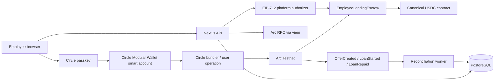

# Blockchain Components in P2P Lending

Last reviewed: 2026-10-09

## 1. Purpose and scope

This document inventories the blockchain-related components currently present in the P2P Lending project. It covers the Arc network integration, Circle smart wallets, Solidity contracts, on-chain lending workflows, server-side authorization, event reconciliation, persistence, APIs, configuration, deployment tooling, tests, and operational documentation.

The project has two distinct concepts that should not be confused:

- **On-chain wallet and settlement:** Circle Modular Wallet smart accounts transact with `EmployeeLendingEscrow` on Arc Testnet using USDC.
- **Internal application ledger:** PostgreSQL ledger accounts and entries support application accounting and legacy flows. They are not blockchain wallets and are not the source of truth for an on-chain transaction.

## 2. Architecture summary



The normal transaction pattern is:

1. The authenticated server validates the user, organization, employment state, policy, wallet, and current on-chain state.
2. The server creates a pending database intent and returns the exact contract call data required by the browser.
3. The employee confirms the action with a device passkey.
4. The Circle smart account submits an account-abstraction user operation to Arc.
5. The browser returns the resulting transaction hash to the server.
6. The server verifies the successful receipt, emitted event, contract address, chain state, wallet addresses, amounts, and identifiers before finalizing application records.
7. If the browser confirmation callback is lost, the reconciliation worker can recover the finalized event later.

## 3. Network and asset configuration

### Arc Testnet

The active blockchain target is **Arc Testnet**:

| Property                | Value                                        |
| ----------------------- | -------------------------------------------- |
| Chain name              | Arc Testnet                                  |
| Chain ID                | `5042002`                                    |
| RPC URL                 | `https://rpc.testnet.arc.io`                 |
| Block explorer          | `https://explorer.testnet.arc.io`            |
| Native asset            | USDC                                         |
| Native asset decimals   | 18                                           |
| ERC-20 USDC address     | `0x3600000000000000000000000000000000000000` |
| ERC-20 USDC decimals    | 6                                            |
| Application wallet type | `CIRCLE_MODULAR`                             |

These definitions live in `src/integrations/arc/arc-testnet.ts`. The code intentionally distinguishes Arc's native 18-decimal representation, used for gas or `msg.value`, from the canonical ERC-20 USDC interface, which uses 6 decimals for application transfers.

### Local development chain

The project also supports a local Hardhat chain:

| Property       | Value                                      |
| -------------- | ------------------------------------------ |
| Chain ID       | `31337`                                    |
| Default RPC    | `http://127.0.0.1:8545`                    |
| Token          | `Development Mock USDC` (`mUSDC`)          |
| Token decimals | 6                                          |
| Accounts       | Hardhat deterministic development accounts |

The local chain is isolated from Arc Testnet configuration. A local deployment produces `deployments/local.json`, including the specific Hardhat instance ID, deployed contract addresses, authorization signer, and funded development accounts. Tests reject stale manifests from a previous chain instance.

## 4. Wallet components

### Circle Modular Wallet

The user-facing on-chain wallet is a **Circle Modular Wallet smart account**. It is controlled with a WebAuthn device passkey rather than MetaMask, WalletConnect, or a browser extension.

Core implementation: `src/modules/arc-wallet/ui/circle-wallet-provider.tsx`

It performs the following work:

- creates or reconnects a Circle WebAuthn credential;
- selects registration or login mode as appropriate;
- derives a WebAuthn-owned smart account;
- connects to Circle's Arc Testnet modular transport;
- creates a Circle bundler client;
- submits one or more calls as a user operation;
- waits for the user-operation receipt; and
- returns the underlying Arc transaction hash to the application.

The provider supports batched calls. Offer funding and repayment use this to combine USDC approval and the escrow action into one wallet-confirmed operation.

### Wallet identity and enrollment

Wallet enrollment is a server-bound ownership verification flow:

1. The server creates a deterministic Circle username from the application user ID.
2. The database records enrollment state such as `NOT_STARTED`, `REGISTERING`, `REGISTERED`, `VERIFYING`, `ACTIVE`, or `FAILED_RECOVERABLE`.
3. The browser registers or reconnects the passkey and resolves the Circle smart-account address.
4. The server issues a short-lived challenge bound to the organization, user, network, and address.
5. The wallet signs the challenge.
6. The server verifies the signature through the Arc client and activates the wallet.

Important protections include nonce hashing, challenge expiry, one-time challenge consumption, organization membership checks, unique wallet addresses, and rejection when a recovered passkey resolves to a different address than the enrolled wallet.

The wallet belongs to the application user, not to an organization. When an
employee leaves one organization and later joins another through the same
platform identity, **Reconnect existing wallet** uses Circle passkey login,
derives the existing address, and records a fresh organization-bound ownership
challenge. It does not create a second wallet or transfer wallet custody. An
employee cannot attach another user's address because activation still requires
a valid signature from that smart account and addresses remain globally unique.
If a new employer created a different application user (for example, because
the work email changed), the same signed challenge may relink the wallet only
after the former user has no active organization memberships. An active former
account blocks reassignment and requires review.

Main files:

- `src/modules/arc-wallet/application/arc-wallet-identity.ts`
- `src/modules/arc-wallet/application/arc-wallet-enrollment.ts`
- `src/modules/arc-wallet/infrastructure/circle-arc-client.ts`
- `src/modules/arc-wallet/infrastructure/prisma-arc-wallet-repository.ts`
- `src/modules/arc-wallet/ui/circle-wallet-provider.tsx`
- `src/modules/arc-wallet/ui/arc-wallet-panel.tsx`

### Wallet persistence

The Prisma `ArcWallet` model stores:

- user ownership, independently of organization membership;
- EVM wallet address;
- network (`ARC_TESTNET`);
- chain ID (`5042002`);
- wallet type (`CIRCLE_MODULAR`);
- wallet status (`PENDING`, `ACTIVE`, or `FAILED`); and
- enrollment state.

`ArcWalletChallenge` stores the address, hashed nonce, expiry, and consumption time for ownership verification. Raw passkeys, recovery secrets, and private keys are not stored in these models.

The employee wallet panel displays the complete address and provides copy and
Arc Explorer actions. `/wallet-access` is available without an active
organization session so a former employee can reconnect the existing passkey
and view the address and balances. It is deliberately read-only and never
submits a transaction. Passkeys remain scoped to the configured Circle client
and passkey domain; deployments using a different client or domain are not
automatically portable. A Circle recovery signer is not generated or retained
by the application.

## 5. Smart contracts

### `EmployeeLendingEscrow`

Source: `contracts/EmployeeLendingEscrow.sol`

The primary Solidity contract is compiled with Solidity `0.8.28`. It imports OpenZeppelin implementations for safe ERC-20 transfers, EIP-712 typed data, signature checking, and reentrancy protection.

#### Immutable constructor dependencies

- `usdc`: the ERC-20 asset accepted by the escrow.
- `authorizationSigner`: the platform address allowed to authorize eligible borrowers.

Changing either immutable requires deploying a replacement contract.

#### Stored offer data

Each `LoanOffer` stores:

- offer ID;
- lender address;
- principal;
- interest rate in basis points;
- duration in seconds;
- active state; and
- unique request ID.

#### Stored loan data

Each `Loan` stores:

- loan ID and originating offer ID;
- lender and borrower addresses;
- principal and interest rate;
- total repayment amount;
- start and due timestamps;
- status (`ACTIVE`, `REPAID`, or `DEFAULTED`); and
- repayment timestamp.

The contract also tracks the next offer and loan IDs, total reserved principal, used request IDs, used borrow authorizations, and the loan created from each offer.

#### Contract functions

`createOffer(principal, interestBps, duration, requestId)`:

- validates nonzero principal, duration, and request ID;
- caps interest at 10,000 basis points;
- rejects duplicate request IDs;
- transfers the exact principal from the lender into escrow;
- rejects fee-on-transfer or otherwise unsupported token behavior;
- increases reserved principal; and
- emits `OfferCreated`.

`cancelOffer(offerId)`:

- allows only the lender to cancel an active offer;
- marks the offer inactive;
- decreases reserved principal;
- returns the escrowed principal; and
- emits `OfferCancelled`.

`acceptOffer(offerId, authorizationExpiry, authorizationId, signature)`:

- rejects zero, expired, invalid, or previously consumed authorizations;
- prevents a lender from borrowing their own offer;
- verifies the platform's EIP-712 authorization for the calling wallet;
- calculates interest once and rounds fractional USDC base units upward;
- consumes the offer and authorization atomically;
- creates an active loan and calculates its due time from `block.timestamp`;
- transfers principal from escrow to the borrower; and
- emits `LoanStarted`.

`repayLoan(loanId)`:

- permits only the recorded borrower to repay an active loan;
- marks the loan repaid;
- transfers the exact repayment amount directly from borrower to lender; and
- emits `LoanRepaid`.

#### Events

- `OfferCreated`
- `OfferCancelled`
- `LoanStarted`
- `LoanRepaid`

The application reconciliation subsystem currently consumes `OfferCreated`, `LoanStarted`, and `LoanRepaid`.

#### Contract security controls

- `ReentrancyGuard` on all token-moving functions.
- `SafeERC20` for token transfers.
- exact balance-delta validation when funding an offer.
- one-time request IDs for idempotency.
- one-time EIP-712 authorization IDs.
- authorization expiry enforcement.
- `msg.sender` binding for lender and borrower actions.
- self-borrowing prevention.
- state updates occur before external transfers where applicable; a failed transfer reverts the transaction.

### `MockUSDC`

Source: `contracts/test/MockUSDC.sol`

This development-only ERC-20 contract provides 6-decimal mock USDC, minting support, and a configurable transfer-failure path for contract and integration tests. It must never be treated as real USDC or used outside local development.

### TypeScript ABI definitions

`src/integrations/arc/employee-lending-escrow.ts` defines the application ABI subsets for:

- USDC `decimals`, `approve`, and `balanceOf`;
- escrow configuration and state reads;
- `createOffer`, `acceptOffer`, and `repayLoan` writes; and
- the three reconciled escrow events.

The same module validates the configured escrow address and converts application funding request UUIDs into `bytes32` request IDs using Keccak-256.

## 6. EIP-712 borrow authorization

An active public offer cannot be accepted by any arbitrary wallet. Before the transaction, the application server revalidates eligibility and signs a five-minute EIP-712 authorization.

The typed `BorrowAuthorization` contains:

- exact on-chain offer ID;
- exact borrower Circle smart-account address;
- expiry timestamp; and
- one-time authorization ID derived from the application's borrow request ID.

The EIP-712 domain binds the signature to:

- name `EmployeeLendingEscrow`;
- version `1`;
- Arc chain ID; and
- the deployed escrow contract address.

Implementation files:

- `src/modules/loans/domain/borrow-authorization.ts`
- `src/modules/loans/infrastructure/borrow-authorization-signer.ts`
- `src/modules/loans/application/onchain-borrow.ts`
- `docs/BORROW_AUTHORIZATION.md`

The server-side private key is configured as `ARC_BORROW_AUTHORIZER_PRIVATE_KEY`. It must never be prefixed with `NEXT_PUBLIC_`, sent to the browser, logged, or stored in PostgreSQL. The matching public address is embedded immutably in the deployed escrow. Key rotation therefore requires a replacement contract and a migration or wind-down plan.

## 7. On-chain business workflows

### Fund a lending offer

Application service: `src/modules/lending/application/funded-lending-offer.ts`

Browser UI: `src/modules/lending/ui/create-lending-offer-form.tsx`

Flow:

1. The server validates the lender's active membership, policy access, active Circle wallet, Arc chain, configured escrow, terms, and USDC balance.
2. It creates a pending funded-offer intent and returns USDC and escrow call data.
3. The Circle wallet submits a batched user operation containing:
   - `USDC.approve(escrow, principal)`; and
   - `EmployeeLendingEscrow.createOffer(...)`.
4. The browser sends the resulting transaction hash to the confirmation API.
5. The server waits for and validates the successful receipt and exact `OfferCreated` fields.
6. Only then is the database offer marked `FUNDED` and `ACTIVE`.

Legacy database-only offers remain marked `LEGACY` and are not eligible for the on-chain marketplace.

### Accept an offer and borrow

Application service: `src/modules/loans/application/onchain-borrow.ts`

Browser UI: `src/app/(employee)/app/borrow/[offerId]/confirm-borrow-form.tsx`

Flow:

1. The server validates tenant membership, employment status, borrow policy, wallet ownership, configured chain, and the live contract offer.
2. It creates a `REQUESTED` loan intent.
3. The versioned origination engine records its result. Missing verified income or tenure requires employer review.
4. An employer administrator records an immutable approval rationale, transitioning the application to `APPROVED`; this does not move funds.
5. On employee retry, the server revalidates eligibility, policy, exposure, offer and chain state before signing the five-minute EIP-712 borrow authorization.
6. The Circle wallet calls `EmployeeLendingEscrow.acceptOffer(...)`.
7. The contract consumes the offer, creates the loan, and transfers escrowed principal to the borrower atomically.
8. The server verifies the receipt, `LoanStarted` event, addresses, amounts, offer ID, and current contract state.
9. The application loan becomes `ACTIVE` only after successful verification.

The organization boundary is enforced by the application; it is not encoded in the public smart contract.

### Repay a loan

Application service: `src/modules/loans/application/onchain-repayment.ts`

Browser UI: `src/app/(employee)/app/loans/[loanId]/repayment-form.tsx`

Flow:

1. The server verifies the authenticated borrower, wallet, database loan, current contract loan, repayment amount, and USDC balance.
2. It creates a pending repayment intent.
3. The Circle wallet submits a batched user operation containing:
   - `USDC.approve(escrow, repaymentAmount)`; and
   - `EmployeeLendingEscrow.repayLoan(chainLoanId)`.
4. The contract transfers repayment directly from borrower to lender.
5. The server validates the receipt and exact `LoanRepaid` event before recording completion.

### Browser interruption recovery

`src/modules/transactions/browser-pending-operation.ts` stores loan-acceptance and repayment intent IDs, request IDs, optional transaction hashes, and save timestamps in browser storage. This enables the UI to retry server confirmation after navigation, refresh, timeout, or a lost callback without resubmitting the blockchain transaction.

## 8. API surface

### Wallet enrollment APIs

| Route                                        | Purpose                                              |
| -------------------------------------------- | ---------------------------------------------------- |
| `POST /api/wallet/arc/enrollment`            | Begin or resume Circle wallet enrollment.            |
| `POST /api/wallet/arc/enrollment/registered` | Persist completion of passkey registration.          |
| `POST /api/wallet/arc/challenge`             | Issue a short-lived wallet-ownership challenge.      |
| `POST /api/wallet/arc/complete`              | Verify the signed challenge and activate the wallet. |
| `GET /api/wallet`                            | Return authenticated wallet information.             |

### On-chain offer APIs

| Route                                                        | Purpose                                                |
| ------------------------------------------------------------ | ------------------------------------------------------ |
| `POST /api/lending-offers/funding-intents`                   | Validate and create a pending on-chain offer intent.   |
| `POST /api/lending-offers/funding-intents/[offerId]/confirm` | Verify the funding transaction and activate the offer. |

### On-chain borrowing APIs

| Route                                              | Purpose                                                         |
| -------------------------------------------------- | --------------------------------------------------------------- |
| `POST /api/lending-offers/[id]/acceptance-intents` | Validate eligibility and prepare a signed borrow authorization. |
| `POST /api/loans/[id]/acceptance/confirm`          | Verify the transaction and activate the loan.                   |

Older direct borrow endpoints remain in the repository but instruct clients to use the wallet confirmation flow.

### On-chain repayment APIs

| Route                                                          | Purpose                                                |
| -------------------------------------------------------------- | ------------------------------------------------------ |
| `POST /api/loans/[id]/repayment-intents`                       | Validate and prepare an on-chain repayment.            |
| `POST /api/loans/[id]/repayment-intents/[repaymentId]/confirm` | Verify the repayment transaction and finalize records. |

Older direct repayment endpoints remain in the repository but do not replace the receipt-verified wallet flow.

### Reconciliation API

| Route                                   | Purpose                                           |
| --------------------------------------- | ------------------------------------------------- |
| `POST /api/internal/arc-reconciliation` | Run a bounded, authenticated reconciliation pass. |

The internal route requires a constant-time-checked bearer token matching
`ARC_RECONCILIATION_CRON_SECRET`. Production Compose runs an internal-only
`reconciliation-scheduler` sidecar that invokes it sequentially at the
configured interval. Concurrent or duplicate invocations remain safe because
the worker acquires a PostgreSQL lease and event application is idempotent.

## 9. Receipt verification and chain reads

The application uses `viem` public clients for Arc RPC access. It does not trust a transaction hash by itself.

Confirmation handlers verify, as applicable:

- chain ID and configured contract address;
- successful transaction receipt status;
- expected event name and log origin;
- exact offer or loan ID;
- lender and borrower wallet addresses;
- principal and repayment amounts;
- interest, duration, start time, and due time;
- request or authorization identifiers;
- current on-chain offer or loan state; and
- uniqueness of the submitted transaction hash.

Receipts also contain account-abstraction and USDC logs, so the parsers deliberately select only the expected escrow event emitted by the configured contract.

Generic blockchain health reads are implemented in `src/integrations/blockchain/blockchain-read-client.ts`. Arc-specific reads also exist in the offer, borrow, repay, wallet, preflight, and reconciliation components.

## 10. Blockchain reconciliation

Module: `src/modules/blockchain-reconciliation`

The reconciliation worker recovers finalized `OfferCreated`, `LoanStarted`, and `LoanRepaid` events when normal browser confirmation is missed.

It has four principal parts:

- `domain/blockchain-event.ts`: event and reconciliation domain types.
- `application/ports.ts`: event-source and repository interfaces.
- `application/reconcile-blockchain-events.ts`: bounded scan, retries, confirmation depth, rewind, lease, and application logic.
- `infrastructure/viem-arc-event-source.ts`: Arc log and contract-state reads.
- `infrastructure/prisma-reconciliation-repository.ts`: cursor, journal, matching, validation, and database updates.

Important behavior:

- the worker never sends a blockchain transaction;
- production Compose starts a dedicated authenticated scheduler sidecar;
  non-Compose deployments must provide an equivalent trigger;
- a pass writes reconciliation cursor, lease, journal, and run-health state and
  may apply a validated finalized event to an already-matched financial record;
- overlapping invocations are protected by a database lease;
- the cursor resumes from the prior scan and rewinds by the configured reorganization window;
- events remain provisional until the required confirmation depth;
- disappearing provisional events become `REORGED`;
- changed or missing finalized events become `CONFLICT` and are not silently reversed;
- unmatched finalized events remain journaled with investigation codes and are retried; and
- no unmatched financial record is invented solely from an event.
- each run is bounded and reports finalized-head backlog and remaining work;
- block-lag and time-based staleness are exposed in dependency health; and
- persistent alert transitions prevent floods across worker restarts and emit
  one recovery when health returns.

Operational entry points:

- `npm run reconcile:arc` performs one bounded reconciliation pass.
- `npm run audit:arc` performs a read-only comparison of database records, escrow state, stale intents, and journal exceptions.
- `reconciliation-scheduler` calls the authenticated internal API every 60
  seconds by default.

## 11. Database components

### Wallet tables

- `ArcWallet`
- `ArcWalletChallenge`

### Offer fields related to blockchain state

The `LendingOffer` model includes fields for funding status, lender wallet, chain ID, contract address, chain offer ID, funding request ID, funding transaction hash, base-unit amounts, and failure information. The database uses uniqueness constraints and indexes to prevent duplicate chain linkage and support marketplace and reconciliation queries.

### Loan fields related to blockchain state

The `Loan` model includes lender and borrower wallet addresses, chain ID, contract address, chain loan and offer IDs, principal and repayment base units, acceptance transaction hash, repayment transaction hash, and chain-derived lifecycle timestamps.

### Reconciliation tables

`BlockchainReconciliationCursor` stores the contract-specific next block, finalized position, lease, observed head, success or failure time, and consecutive failure count.

`BlockchainEvent` stores the chain, contract, block, block hash, transaction hash, log index, event name, provisional/finalized state, serialized payload, matched application record, and investigation details. The combination of chain, contract, transaction hash, and log index is unique.

### Relevant migrations

- `20260929120634_arc_wallet_foundation`
- `20260929130049_arc_wallet_enrollment_state`
- `20260929170000_funded_lending_offers`
- `20260929210000_onchain_loan_acceptance`
- `20260929213000_unique_chain_loan`
- `20260929220000_onchain_loan_repayment`
- `20261003050000_blockchain_reconciliation`
- `20261004020000_operational_health`

## 12. Configuration variables

Only public addresses and non-secret settings should be exposed to browser code. Never place private keys or cron secrets in a `NEXT_PUBLIC_` variable.

### Public Circle and contract configuration

| Variable                                   | Purpose                                                          |
| ------------------------------------------ | ---------------------------------------------------------------- |
| `NEXT_PUBLIC_CIRCLE_CLIENT_KEY`            | Public Circle Modular Wallet SDK client identifier.              |
| `NEXT_PUBLIC_CIRCLE_CLIENT_URL`            | Circle modular wallet service URL.                               |
| `NEXT_PUBLIC_ARC_LENDING_CONTRACT_ADDRESS` | Deployed escrow address used by browser transaction preparation. |

### Server-side Arc configuration

| Variable                                 | Purpose                                                      |
| ---------------------------------------- | ------------------------------------------------------------ |
| `ARC_CHAIN_ID`                           | Must resolve to Arc Testnet chain ID `5042002`.              |
| `ARC_RPC_URL`                            | Server-side Arc RPC endpoint.                                |
| `ARC_USDC_ADDRESS`                       | Canonical Arc Testnet USDC contract address.                 |
| `ARC_BORROW_AUTHORIZER_PRIVATE_KEY`      | Secret key that signs EIP-712 borrow authorizations.         |
| `ARC_BORROW_AUTHORIZER_ADDRESS`          | Public authorizer address used during deployment validation. |
| `ARC_DEPLOYER_PRIVATE_KEY`               | Secret deployment account key.                               |
| `ARC_ESCROW_DEPLOYMENT_TRANSACTION_HASH` | Deployment record used by operational checks.                |

### Reconciliation configuration

| Variable                                 | Purpose                                         |
| ---------------------------------------- | ----------------------------------------------- |
| `ARC_RECONCILIATION_ENABLED`             | Enables scheduled reconciliation.               |
| `ARC_RECONCILIATION_RPC_URL`             | RPC used by the worker.                         |
| `ARC_RECONCILIATION_START_BLOCK`         | Escrow deployment block and initial scan point. |
| `ARC_RECONCILIATION_CONFIRMATIONS`       | Blocks required before finalization.            |
| `ARC_RECONCILIATION_BLOCK_RANGE`         | Maximum blocks fetched per range.               |
| `ARC_RECONCILIATION_REORG_WINDOW`        | Number of prior blocks rescanned.               |
| `ARC_RECONCILIATION_MAX_RANGES`          | Bound on work per invocation.                   |
| `ARC_RECONCILIATION_RPC_RETRIES`         | RPC retry count.                                |
| `ARC_RECONCILIATION_STALE_AFTER_MINUTES` | Operational staleness threshold.                |
| `ARC_RECONCILIATION_INTERVAL_SECONDS`    | Scheduler cadence; defaults to 60 seconds.      |
| `ARC_RECONCILIATION_CRON_SECRET`         | Bearer secret for the internal worker route.    |
| `OPERATIONAL_ALERT_WEBHOOK_URL`          | Optional sanitized alert/recovery JSON target.  |
| `OPERATIONAL_ALERT_WEBHOOK_BEARER_TOKEN` | Optional secret used only for webhook delivery. |

### Local-chain configuration

| Variable                    | Purpose                                                    |
| --------------------------- | ---------------------------------------------------------- |
| `CHAIN_ID`                  | Application chain selection for local or Arc environments. |
| `RPC_URL` / `LOCAL_RPC_URL` | Local Hardhat RPC endpoint.                                |
| `USDC_ADDRESS`              | Locally deployed mock token address.                       |
| `LENDING_CONTRACT_ADDRESS`  | Locally deployed escrow address.                           |

Validation lives in `src/infrastructure/config/environment-schema.ts`. Examples live in `.env.example` and `deploy/.env.production.example`. Real `.env` values and all private keys must remain uncommitted.

## 13. Deployment and local-chain tooling

### Hardhat configuration

`hardhat.config.ts` provides:

- Solidity `0.8.28`;
- an optimized production build profile with 200 optimizer runs;
- an in-process simulated Hardhat network;
- a local HTTP network on chain `31337`; and
- an Arc Testnet HTTP network using `ARC_DEPLOYER_PRIVATE_KEY`.

### Arc deployment

`scripts/deploy-lending-escrow.ts`:

- refuses to run on any network except `arcTestnet`;
- verifies the configured public authorizer is nonzero;
- derives the public address from the private authorizer key and requires an exact match;
- verifies chain ID `5042002`;
- verifies deployed code at the canonical USDC address;
- deploys `EmployeeLendingEscrow`;
- waits for a successful receipt;
- verifies constructor bindings on-chain; and
- prints the public contract address, deployment hash, deployment block, signer, and USDC address.

The project never deploys the production contract automatically.

### Local chain lifecycle

Relevant scripts:

- `scripts/start-local-chain.ts`
- `scripts/stop-local-chain.ts`
- `scripts/reset-local-chain.ts`
- `scripts/local-chain-process.ts`
- `scripts/deploy-local-chain.ts`
- `scripts/local-chain-deployment.ts`
- `scripts/run-local-chain-tests.ts`

The deployment script deploys `MockUSDC`, mints 1,000,000 mUSDC each to the deployer, lender, and borrower development accounts, deploys the escrow with a separate authorizer account, and writes an instance-bound manifest.

### Pilot and operational scripts

- `scripts/configure-arc-pilot-secrets.ts`: prepares dedicated pilot secrets and reports only safe public information.
- `scripts/preflight-arc-pilot.ts`: read-only verification of RPC, USDC, escrow bytecode and constructor bindings, authorizer matching, Circle configuration, two exact ownership-verified wallets, ERC-20 and native fee balances, database readiness, and persisted reconciliation health/cursor lag.
- `scripts/reconcile-arc.ts`: runs a configured reconciliation pass.
- `scripts/audit-arc-reconciliation.ts`: performs a read-only database-versus-chain audit.
- `scripts/run-arc-reconciliation-scheduler.mjs`: runs the internal authenticated production cadence.

## 14. Commands

```bash
# Compile and unit-test Solidity
npm run contracts:compile
npm run test:contracts

# Deploy deliberately to Arc Testnet
npm run contracts:deploy:arc

# Managed local chain
npm run chain:start
npm run chain:deploy
npm run chain:reset
npm run chain:stop

# Complete isolated local blockchain integration suite
npm run chain:test

# Arc pilot and operations
npm run pilot:configure-secrets
npm run pilot:preflight
npm run reconcile:arc
npm run audit:arc
```

## 15. Blockchain dependencies

| Package                                 | Role                                                                                                         |
| --------------------------------------- | ------------------------------------------------------------------------------------------------------------ |
| `@circle-fin/modular-wallets-core`      | Circle passkey wallet, modular smart-account, bundler, and user-operation integration.                       |
| `viem`                                  | EVM addresses, chain clients, ABI encoding/decoding, typed-data signing, receipts, logs, and contract reads. |
| `hardhat`                               | Solidity compilation, local EVM network, testing, and deployment.                                            |
| `@nomicfoundation/hardhat-toolbox-viem` | Hardhat integration with viem clients and contract helpers.                                                  |
| `@openzeppelin/contracts`               | ERC-20 safety, EIP-712, signature verification, reentrancy guard, and test ERC-20 foundations.               |

## 16. Test coverage

### Contract tests

`contracts-test/EmployeeLendingEscrow.test.ts` covers the escrow lifecycle and adverse cases, including offer funding and cancellation, duplicate requests, invalid terms, accept authorization, wrong borrowers, self-borrowing, replay, expiry, loan creation, repayment, token-transfer failure, and reentrancy-sensitive behavior.

### Wallet tests

- `tests/arc-wallet-identity.test.ts`
- `tests/arc-wallet-enrollment.test.ts`
- `tests/arc-wallet-database.test.ts`
- `tests/employee-onboarding-experience.test.ts`

### On-chain application tests

- `tests/funded-lending-offer.test.ts`
- `tests/onchain-borrow.test.ts`
- `tests/onchain-borrow-organization.test.ts`
- `tests/onchain-repayment-ui.test.tsx`
- `tests/intent-concurrency.test.ts`

### Reconciliation and operational tests

- `tests/blockchain-reconciliation.test.ts`
- `tests/blockchain-reconciliation-database.test.ts`
- `tests/blockchain-environment.test.ts`
- `tests/operational-health.test.ts`
- `tests/disaster-recovery-database.test.ts`

### Local-chain integration tests

- `tests/local-chain.test.ts`
- `tests/local-chain-manifest.test.ts`
- `tests/p2p-lending-local-e2e.test.ts`
- `vitest.local-chain.config.mts`

The local end-to-end suite starts a clean node, deploys contracts, applies migrations, validates the manifest, executes RPC and database-backed lending flows, and stops the node.

## 17. Health, monitoring, and recovery

Dependency health checks inspect Arc RPC, chain ID, USDC bytecode, escrow bytecode and bindings, Circle configuration, reconciliation freshness, and related deployment settings.

Relevant files include:

- `src/server/application/health/get-configured-dependency-health.ts`
- `src/server/application/health/build-dependency-health.ts`
- `src/infrastructure/database/repositories/prisma-operational-health-repository.ts`
- `src/infrastructure/observability/operational-signals.ts`

Database backup is essential even though the chain contains finalized escrow transitions. The chain cannot reconstruct application users, organizations, memberships, employment state, wallet ownership bindings, policy decisions, internal intents, or tenant relationships. See `docs/DATABASE_BACKUP_AND_DISASTER_RECOVERY.md`.

## 18. Trust boundaries and security notes

- **User key boundary:** users authorize Circle smart-account operations with passkeys; the application does not store their private keys.
- **Platform authorizer boundary:** the server can authorize eligible borrowers. Compromise of this key could authorize an attacker-controlled wallet for an active offer.
- **Deployment key boundary:** the Arc deployer key can deploy contracts but is separate from user wallet credentials.
- **Application policy boundary:** employer membership, employment, tenant isolation, and lending policy are server-side controls, not smart-contract rules.
- **Chain source of truth:** a receipt and exact escrow event are required before application completion; a browser success message or transaction hash alone is insufficient.
- **Reconciliation boundary:** reconciliation may apply only validated, matched events and cannot invent unmatched financial records.
- **Public contract limitation:** any wallet with a valid platform authorization can accept an active offer; the authorization service is therefore a critical policy enforcement component.
- **Immutability consideration:** changing USDC or the authorization signer requires redeployment, and outstanding offers or loans require an explicit compatibility or wind-down plan.
- **Testnet limitation:** Arc Testnet, test USDC, local Hardhat accounts, and mock USDC are not production assets.

## 19. Current deployment status recorded in the repository

`docs/ARC_TESTNET_PILOT_REPORT.md`, updated 2026-10-11, records one verified
Arc Testnet lifecycle: a 2.50 USDC offer, disbursement, and 2.625 USDC full
repayment. All three successful receipts were matched to exact escrow events,
USDC transfers, application records, and finalized `APPLIED` reconciliation
journal rows. The report permits a continued controlled testnet pilot but keeps
unattended and production operation blocked pending scheduler and ERPNext
freshness evidence. `docs/ARC_TESTNET_CONTROLLED_LENDING_RUNBOOK.md` remains the
approval boundary for any additional fund-moving run.

This is historical status documentation, not a guarantee of current runtime state. Before claiming readiness, rerun `npm run pilot:preflight` against the intended environment and confirm a real two-wallet Arc Testnet lifecycle.

## 20. File inventory

### Contracts and ABIs

- `contracts/EmployeeLendingEscrow.sol`
- `contracts/test/MockUSDC.sol`
- `src/integrations/arc/employee-lending-escrow.ts`

### Network and blockchain integration

- `src/integrations/arc/arc-testnet.ts`
- `src/integrations/blockchain/blockchain-read-client.ts`
- `src/integrations/blockchain/local-chain.ts`
- `hardhat.config.ts`
- `local-chain.config.json`

### Circle wallet module

- `src/modules/arc-wallet/api/arc-wallet-response.ts`
- `src/modules/arc-wallet/application/arc-wallet-enrollment.ts`
- `src/modules/arc-wallet/application/arc-wallet-identity.ts`
- `src/modules/arc-wallet/application/errors.ts`
- `src/modules/arc-wallet/application/ports/arc-wallet-repository.ts`
- `src/modules/arc-wallet/domain/arc-wallet.ts`
- `src/modules/arc-wallet/index.server.ts`
- `src/modules/arc-wallet/infrastructure/circle-arc-client.ts`
- `src/modules/arc-wallet/infrastructure/prisma-arc-wallet-repository.ts`
- `src/modules/arc-wallet/schemas/arc-wallet-enrollment.schema.ts`
- `src/modules/arc-wallet/schemas/arc-wallet.schema.ts`
- `src/modules/arc-wallet/ui/arc-wallet-panel.tsx`
- `src/modules/arc-wallet/ui/circle-wallet-provider.tsx`

### Offer, borrow, and repayment application code

- `src/modules/lending/application/funded-lending-offer.ts`
- `src/modules/lending/schemas/funded-lending-offer.schema.ts`
- `src/modules/lending/ui/create-lending-offer-form.tsx`
- `src/modules/loans/application/onchain-borrow.ts`
- `src/modules/loans/application/onchain-repayment.ts`
- `src/modules/loans/domain/borrow-authorization.ts`
- `src/modules/loans/domain/onchain-borrow.ts`
- `src/modules/loans/infrastructure/borrow-authorization-signer.ts`
- `src/modules/loans/schemas/onchain-borrow.schema.ts`
- `src/modules/loans/schemas/onchain-repayment.schema.ts`
- `src/modules/transactions/browser-pending-operation.ts`
- `src/app/(employee)/app/borrow/[offerId]/confirm-borrow-form.tsx`
- `src/app/(employee)/app/loans/[loanId]/repayment-form.tsx`

### Reconciliation

- `src/modules/blockchain-reconciliation/README.md`
- `src/modules/blockchain-reconciliation/domain/blockchain-event.ts`
- `src/modules/blockchain-reconciliation/application/ports.ts`
- `src/modules/blockchain-reconciliation/application/reconcile-blockchain-events.ts`
- `src/modules/blockchain-reconciliation/infrastructure/viem-arc-event-source.ts`
- `src/modules/blockchain-reconciliation/infrastructure/prisma-reconciliation-repository.ts`
- `src/modules/blockchain-reconciliation/index.server.ts`
- `src/app/api/internal/arc-reconciliation/route.ts`

### API routes

- `src/app/api/wallet/arc/enrollment/route.ts`
- `src/app/api/wallet/arc/enrollment/registered/route.ts`
- `src/app/api/wallet/arc/challenge/route.ts`
- `src/app/api/wallet/arc/complete/route.ts`
- `src/app/api/lending-offers/funding-intents/route.ts`
- `src/app/api/lending-offers/funding-intents/[offerId]/confirm/route.ts`
- `src/app/api/lending-offers/[id]/acceptance-intents/route.ts`
- `src/app/api/loans/[id]/acceptance/confirm/route.ts`
- `src/app/api/loans/[id]/repayment-intents/route.ts`
- `src/app/api/loans/[id]/repayment-intents/[repaymentId]/confirm/route.ts`

### Deployment and operations scripts

- `scripts/deploy-lending-escrow.ts`
- `scripts/configure-arc-pilot-secrets.ts`
- `scripts/preflight-arc-pilot.ts`
- `scripts/reconcile-arc.ts`
- `scripts/audit-arc-reconciliation.ts`
- `scripts/start-local-chain.ts`
- `scripts/stop-local-chain.ts`
- `scripts/reset-local-chain.ts`
- `scripts/local-chain-process.ts`
- `scripts/deploy-local-chain.ts`
- `scripts/local-chain-deployment.ts`
- `scripts/run-local-chain-tests.ts`

### Database schema and migrations

- `prisma/schema.prisma`
- `prisma/migrations/20260929120634_arc_wallet_foundation/migration.sql`
- `prisma/migrations/20260929130049_arc_wallet_enrollment_state/migration.sql`
- `prisma/migrations/20260929170000_funded_lending_offers/migration.sql`
- `prisma/migrations/20260929210000_onchain_loan_acceptance/migration.sql`
- `prisma/migrations/20260929213000_unique_chain_loan/migration.sql`
- `prisma/migrations/20260929220000_onchain_loan_repayment/migration.sql`
- `prisma/migrations/20261003050000_blockchain_reconciliation/migration.sql`
- `prisma/migrations/20261004020000_operational_health/migration.sql`

### Documentation

- `docs/ARC_TESTNET_DEPLOYMENT.md`
- `docs/ARC_TESTNET_PILOT_REPORT.md`
- `docs/BORROW_AUTHORIZATION.md`
- `docs/LOCAL_CHAIN.md`
- `docs/EMPLOYEE_ONBOARDING_AND_LENDING.md`
- `docs/P2P_LENDING_SECURITY_AUDIT.md`
- `docs/DATABASE_BACKUP_AND_DISASTER_RECOVERY.md`
- `src/modules/lending/README.md`
- `src/modules/loans/README.md`
- `src/modules/blockchain-reconciliation/README.md`

Generated Prisma client files under `src/generated/prisma` mirror the schema models and enums but are build artifacts; they should not be edited by hand.
