# End-to-end loan origination v1

## Verified architecture

Arc origination uses an already funded, single-use `LendingOffer`; it does not
create a new lender offer after an employer review. The employee's application
is a `Loan` linked to that offer in `REQUESTED` state. Review approval unlocks
offer acceptance but is not acceptance, funding, disbursement, or evidence of
an on-chain transaction. This preserves the deployed escrow lifecycle instead
of introducing a second application or offer model.

The legacy internal-ledger loan flow remains for historical/local records. New
Arc loans use the receipt-verified flow documented here and do not create
internal ledger entries for on-chain settlement.

```mermaid
stateDiagram-v2
    [*] --> FundedOffer: lender funds escrow
    FundedOffer --> REQUESTED: employee submits acceptance application
    REQUESTED --> REVIEW_REQUIRED: decision lacks verified income/tenure
    REVIEW_REQUIRED --> CANCELLED: employer rejects with rationale
    REVIEW_REQUIRED --> APPROVED: employer approves with rationale
    APPROVED --> AuthorizationIssued: employee retries; server revalidates
    AuthorizationIssued --> Submitted: employee signs Circle user operation
    Submitted --> APPROVED: receipt unavailable / confirmation pending
    Submitted --> CANCELLED: verified reverted receipt
    Submitted --> ACTIVE: verified LoanStarted + contract state
    APPROVED --> ACTIVE: finalized LoanStarted recovered by reconciliation
    ACTIVE --> OVERDUE: due date passes with balance
    ACTIVE --> REPAID: verified LoanRepaid
    OVERDUE --> REPAID: verified LoanRepaid
    ACTIVE --> DEFAULTED: authorized servicing process
    REPAID --> [*]
    CANCELLED --> [*]
```

`APPROVAL_CONSIDERATION` is only a rules-engine recommendation. It never issues
an authorization without an immutable employer-admin `APPROVED` review.
Automatic score-based approval is disabled.

## Lifecycle controls

| Stage              | Persisted state                             | Authority and checks                                                                                                                                                                              |
| ------------------ | ------------------------------------------- | ------------------------------------------------------------------------------------------------------------------------------------------------------------------------------------------------- |
| Offer preparation  | `LendingOffer(PAUSED/PENDING)`              | Authenticated active employee lender; fresh ERPNext status; lending policy; active Arc wallet; configured escrow; exact USDC balance.                                                             |
| Offer confirmation | `FUNDED/ACTIVE`                             | Successful receipt, exact `OfferCreated`, request ID, lender, principal, fee and duration. A database status alone is insufficient.                                                               |
| Application        | `Loan(REQUESTED)`                           | Employee session, tenant ownership, active/fresh employment, `canBorrow`, Arc wallet ownership, funded active unexpired offer, current policy and exposure, live contract offer, UUID request id. |
| Decision           | immutable `LoanOriginationDecision`         | Versioned input snapshot and idempotency key. Missing income or tenure produces `REVIEW_REQUIRED`; no weight is fabricated.                                                                       |
| Review             | immutable `LoanOriginationOverride`         | Active employer administrator in the same tenant; 20–1000 character rationale; one review per decision; hard-gate failures cannot be approved.                                                    |
| Review approval    | `Loan(APPROVED)`                            | Records `approvedAt` and `LOAN_APPROVED`. No wallet or blockchain operation occurs.                                                                                                               |
| Authorization      | short-lived EIP-712 payload                 | Employee retries the same request. Membership, ERPNext freshness, offer, policy, exposure, contract state, wallet, signer and review are revalidated.                                             |
| Submission         | `APPROVED` plus `acceptanceTransactionHash` | Circle wallet submits only after employee passkey approval. The server persists the hash before receipt lookup; browser recovery also retains the operation ID and hash.                          |
| Confirmation       | `Loan(ACTIVE)`                              | Successful receipt, exact `LoanStarted`, wallets, offer ID, base-unit amounts, timestamps and current contract loan state.                                                                        |
| Recovery           | reconciliation journal                      | Finalized events are idempotently applied; duplicates do not create financial records. Unmatched or conflicting events remain visible.                                                            |
| Repayment          | `PENDING` to `COMPLETED`; loan to `REPAID`  | Borrower ownership, exact chain loan/amount, receipt/event/state verification, and reconciliation recovery.                                                                                       |

Only one unresolved Arc acceptance per offer and one unresolved Arc
application per borrower may exist. The partial unique indexes cover both
`REQUESTED` and contract-backed `APPROVED` records. Request IDs, transaction
hashes, contract authorization IDs, decision keys, repayment IDs and
reconciliation event identities provide additional idempotency boundaries.

## Financial rules

- Monetary application values use `BigInt` integer minor units. Arc transfers
  use six-decimal USDC base units.
- Current Arc offers are single-principal, single-maturity bullet products.
- Interest/fee is applied once for the complete term:
  `ceil(principalBaseUnits * feeRateBasisPoints / 10_000)`.
- Contract repayment is principal plus that rounded-up base-unit fee.
- Application cents conservatively round the exact repayment up to the next
  cent; exact base units remain persisted for receipt reconciliation.
- Contract maturity is `LoanStarted.startTime + offer.duration`; the browser
  cannot choose it.
- Offer principal, fee rate and duration must satisfy the versioned employer
  policy. No new pricing or installment policy is introduced by this workflow.

## Authorization boundary

The employee acceptance endpoint derives the employee and organization from
the authenticated session. It never accepts those identifiers from the
browser. Employer review endpoints require `EMPLOYER_ADMIN`, tenant-scope every
lookup, validate the request origin, apply administrative rate limits, and
record reviewer identity and rationale.

Before signing, the server verifies the configured contract's authorization
signer and binds the five-minute EIP-712 authorization to the offer, borrower
wallet, Arc chain, contract, expiry and one-time authorization ID. Reviewers
cannot accept offers or move funds for employees.

## Recovery semantics

- A receipt lookup timeout leaves the application `APPROVED` with its submitted
  transaction hash; it is not marked active or failed.
- A verified reverted receipt cancels the unexecuted application.
- A successful receipt without the expected escrow event or contract state is
  rejected and remains an investigation/reconciliation concern.
- A database failure after `LoanStarted` is recoverable from the finalized
  event. Reconciliation supports both historical `REQUESTED` intents and the
  reviewer-approved `APPROVED` state.
- Duplicate callbacks and duplicate finalized events are idempotent.
- Reconciliation discrepancies are retained as `UNMATCHED` or `CONFLICT`; they
  are never converted into fabricated loans or repayments.

## Evidence levels

Automated unit/database tests prove authorization, tenant isolation, policy
gates, exact arithmetic, review transitions, concurrent-request exclusion,
receipt handling, and reconciliation recovery. The local-chain test proves the
escrow offer/acceptance/repayment mechanics against a disposable chain.

The receipts in `ARC_TESTNET_PILOT_REPORT.md` prove one earlier live Arc
lifecycle only. They predate this reviewer-state integration and are not live
evidence for the new `REQUESTED -> APPROVED -> ACTIVE` application transition.

## Separately authorized Arc Testnet run

1. Deploy all migrations and the application; verify scheduler health and run
   the read-only ERPNext and Arc audits.
2. Confirm a complete, fresh ERPNext sync, active employee/lender memberships,
   distinct ownership-verified Circle wallets, configured authorizer and escrow,
   and sufficient test USDC/native fee balances.
3. Under explicit transaction approval, have the lender create and fund one
   policy-compliant minimum-value offer. Retain the intent, receipt,
   `OfferCreated`, USDC transfer and reconciled journal evidence.
4. Have the employee submit one acceptance application. Verify `REQUESTED`, one
   decision, `REVIEW_REQUIRED`, one `LOAN_REQUESTED` event, and no wallet call.
5. Have a different employer-admin account review it with a rationale. Verify
   `APPROVED`, `approvedAt`, reviewer metadata, `LOAN_APPROVED`, no transaction
   hash and no balance movement.
6. Have the employee retry the same request ID. Verify the authorization is for
   the same offer, wallet, contract and application and expires within five
   minutes.
7. With separate approval for that transaction, submit `acceptOffer`. Retain
   the successful receipt, exact `LoanStarted`, USDC disbursement and contract
   state. Confirm the database becomes `ACTIVE` only afterward.
8. Allow reconciliation to finalize the event and verify an immediate repeated
   pass creates no duplicate record or audit event.
9. Repay only under separate transaction approval. Verify the exact
   `LoanRepaid` receipt/transfer, database state and reconciliation journal.
10. Run `npm run audit:erpnext`, `npm run audit:arc`, and
    `npm run pilot:preflight`; retain sanitized outputs and scheduler health.

No step in this document grants permission to submit a financial transaction.
